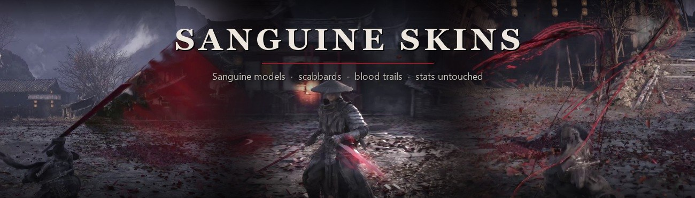
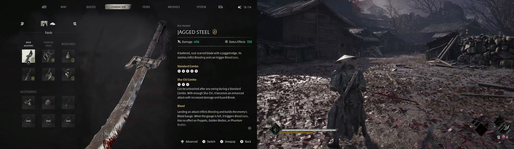
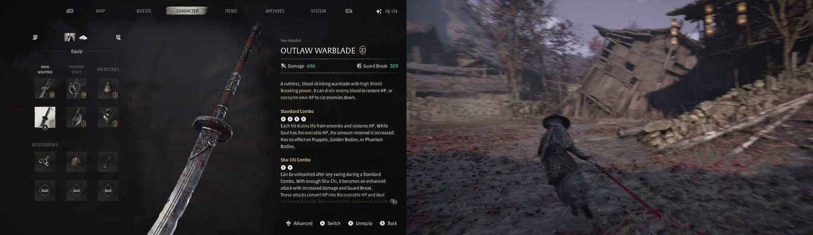
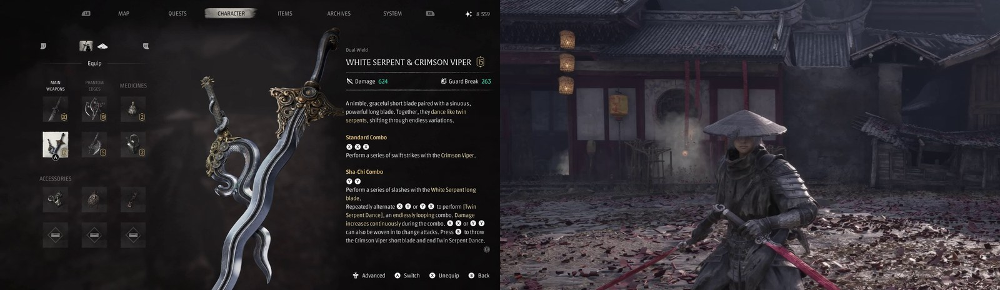
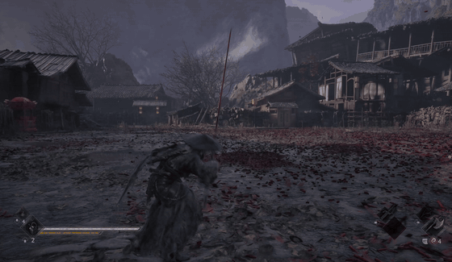
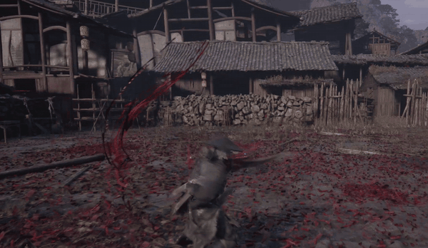

<p align="center"></p>

<p align="center">
  <a href="https://www.nexusmods.com/phantombladezero/mods/399"></a>
  <a href="https://github.com/ayokiru/pbz-sanguine-skins/releases/latest"></a>
  
  <a href="https://github.com/ayokiru/pbz-bladesmith"></a>
  <a href="LICENSE"></a>
</p>

<p align="center">
  <a href="#what-it-looks-like">Screenshots</a> &nbsp;·&nbsp;
  <a href="#files">Files</a> &nbsp;·&nbsp;
  <a href="#install">Install</a> &nbsp;·&nbsp;
  <a href="#no-weapon-trails">No Weapon Trails</a> &nbsp;·&nbsp;
  <a href="#build-it-yourself">Build it yourself</a>
</p>

This mod puts the Sanguine blades on other weapons. Jagged Steel gets the Sanguine sword, the Outlaw Warblade gets the long Sanguine blade, and the White Serpent and Crimson Viper get the paired Sanguine blades, each with its scabbard. Jagged Steel and the serpent blades leave blood trails, the Outlaw Warblade a crimson one. Stats, perks, movesets and hitboxes stay with the original weapon.

The mod lives on [Nexus Mods](https://www.nexusmods.com/phantombladezero/mods/399), and that's the place for comments and requests. This repo has the same files for anyone who can't download from Nexus, and the recipes they're built from.

## What it looks like

<p align="center"></p>
<p align="center"></p>
<p align="center"></p>

<table>
  <tr>
    <td width="50%"></td>
    <td width="50%"></td>
  </tr>
  <tr>
    <td align="center"><sub>Outlaw Warblade, crimson trails</sub></td>
    <td align="center"><sub>White Serpent and Crimson Viper, blood trails</sub></td>
  </tr>
</table>

## Files

Pick one main file. Addons go on top of it. Every file is in the [latest release](https://github.com/ayokiru/pbz-sanguine-skins/releases/latest).

### Main file and its variants

Install only one of these.

| File | What you get | Recipe |
|---|---|---|
| [Full](https://github.com/ayokiru/pbz-sanguine-skins/releases/latest/download/SanguineSkins_BloodTrails_Full_v2.1.zip) | All three skins with their trails | [full](recipes/full.json) |
| [Jagged Steel only](https://github.com/ayokiru/pbz-sanguine-skins/releases/latest/download/SanguineSkins_BloodTrails_JaggedSteel_only_v2.0.zip) | Jagged Steel with blood trails | [jagged-steel-only](recipes/jagged-steel-only.json) |
| [Outlaw Warblade only](https://github.com/ayokiru/pbz-sanguine-skins/releases/latest/download/SanguineSkins_BloodTrails_OutlawWarblade_only_v2.0.zip) | Outlaw Warblade with crimson trails | [outlaw-warblade-only](recipes/outlaw-warblade-only.json) |
| [White Serpent and Crimson Viper only](https://github.com/ayokiru/pbz-sanguine-skins/releases/latest/download/SanguineSkins_BloodTrails_WhiteSerpentCrimsonViper_only_v2.1.zip) | The serpent blades with blood trails | [serpent-viper-only](recipes/serpent-viper-only.json) |
| [Skins only, plain trails](https://github.com/ayokiru/pbz-sanguine-skins/releases/latest/download/SanguineSkins_SkinsOnly_WhiteOutlaw_v2.1.zip) | The three skins with the game's own trails; the Outlaw Warblade leaves a plain white cut | [skins-only-plain-trails](recipes/skins-only-plain-trails.json) |
| [Trails only](https://github.com/ayokiru/pbz-sanguine-skins/releases/latest/download/SanguineSkins_BloodTrails_only_v2.1.zip) | The blood and crimson trails on the original weapon models | [trails-only](recipes/trails-only.json) |

### Addons

These go on top of any main file.

| File | What you get | Recipe |
|---|---|---|
| [Wild Oriole Sword](https://github.com/ayokiru/pbz-sanguine-skins/releases/latest/download/SanguineSkins_WildOrioleSword_addon.zip) | The Sanguine blade on the Wild Oriole sword, its own trails | [wild-oriole-sword-addon](recipes/wild-oriole-sword-addon.json) |
| [Fanatic Swords](https://github.com/ayokiru/pbz-sanguine-skins/releases/latest/download/SanguineSkins_FanaticSwords_addon.zip) | The Sanguine blade on the Fanatic's Broken and Drunken Sword | [fanatic-swords-addon](recipes/fanatic-swords-addon.json) |
| [Bonesaw](https://github.com/ayokiru/pbz-sanguine-skins/releases/latest/download/SanguineSkins_Bonesaw_addon.zip) | The long Sanguine blade with crimson trails on the Bonesaw | [bonesaw-addon](recipes/bonesaw-addon.json) |
| [Jagged Steel, Wild Oriole trails](https://github.com/ayokiru/pbz-sanguine-skins/releases/latest/download/SanguineSkins_JaggedSteel_WildOrioleTrails_addon.zip) | Sanguine Jagged Steel with the Wild Oriole's trails | [jagged-steel-wild-oriole-trails-addon](recipes/jagged-steel-wild-oriole-trails-addon.json) |
| [Dark blades](https://github.com/ayokiru/pbz-sanguine-skins/releases/latest/download/SanguineSkins_DarkBlades_addon.zip) | Darker Sanguine blades | texture edit, no recipe |
| [Gray blades](https://github.com/ayokiru/pbz-sanguine-skins/releases/latest/download/SanguineSkins_GrayBlades_addon.zip) | Gray Sanguine blades | texture edit, no recipe |

## Install

1. Download a zip from the table above.
2. Unpack it into the game folder, the one that has `ProjectPBZ` in it. The files land in `ProjectPBZ\Content\Paks\~mods`.
3. Start the game.

To remove a file, delete its `.pak`, `.ucas` and `.utoc` from `~mods`.

When two paks change the same weapon, the game uses the one whose name sorts first, and capital letters sort before small ones. The addons that change a weapon the main file also changes are named so that they win.

## No Weapon Trails

A separate file you'll only find here. It removes the swing trails from all 29 weapons in the game and keeps their original looks. Kicks lose their trails too. Skills and special attacks keep their effects.

[Download NoWeaponTrails_1.0.zip](https://github.com/ayokiru/pbz-sanguine-skins/releases/latest/download/NoWeaponTrails_1.0.zip) and install it the same way. Its name starts with a small z, so any other mod that changes a weapon wins on that weapon. With Sanguine Skins installed, the Sanguine weapons keep their trails and everything else has none.

Recipe: [no-weapon-trails](recipes/no-weapon-trails.json). Trails set to `none` need Bladesmith 0.5.4 or newer.

## Build it yourself

Every recipe in [`recipes`](recipes) is a [Bladesmith](https://github.com/ayokiru/pbz-bladesmith) recipe. Bladesmith builds the pak from your own copy of the game, so after a game patch you can rebuild a file yourself instead of waiting for an update. Open the recipe in Bladesmith and press Build & install, or run:

```
bladesmith build recipes/full.json --install
```

## License

[MIT](LICENSE) for the recipes, texts and pictures in this repo. Phantom Blade Zero and the game data inside the paks belong to S-GAME.
